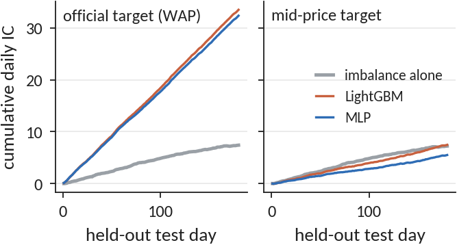
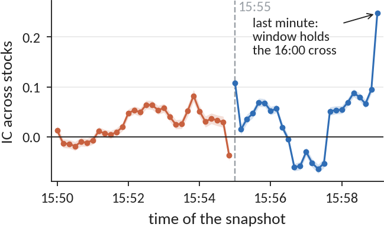
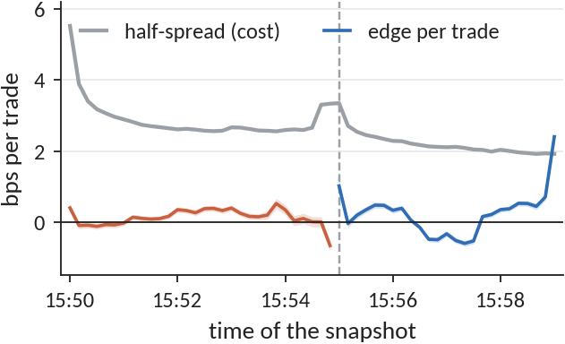

# nasdaq-closing-cross

**Is the Nasdaq closing-auction imbalance already in the price?** A statistical-inference study of 5.2 million
auction snapshots: 200 Nasdaq stocks, 481 trading days, every 10 seconds from 15:50 to 16:00.

Every Nasdaq closing auction publishes its order imbalance in the last ten minutes of trading. If markets price public
information, that imbalance should not predict where a stock goes next. We test whether it does, whether a deep model
finds more, whether a market-structure rule at 15:55 changes the answer, and whether any of it survives the cost of
trading. Every threshold was fixed before the data it governs was analysed.

<p align="center"></p>

*On the official target, learned models leave the imbalance far behind (left). On the plain mid-price move of the
same rows, the imbalance alone is as good (right): the learned gain is an artefact of how the target is built.*

## Findings

| Question | Answer |
|---|---|
| **P1 Information.** Does the published imbalance predict the next-minute move against the index? | **Yes.** +0.47 bps per trade (95% CI 0.44 to 0.49), positive on 458 of 481 days, and fully present in mid-price moves |
| **P2 Learned signal.** Does a neural network trained on the auction state predict it better? | **Only on paper.** IC 0.192 vs 0.052 on the official target, but on mid-price moves the gain is -0.010 (95% CI -0.016 to -0.003). The models learn how the size-weighted mid (WAP) shifts with book depth |
| **P3 Disclosure rule.** Does 15:55, when indicative prices appear and market-on-close entry closes, change predictability? | **Partly.** IC rises 2.5 times and volatility falls by 23%, but a placebo test shows the lasting gain is the final minute, whose window contains the 16:00 closing cross |
| **P4 Tradeability.** Is any edge larger than the half-spread? | **No**, except possibly in the last minute (+0.48 bps net, shrinking from 0.74 to 0.23 across the sample), an exploratory lead |

The information is in the price to within trading costs.

<p align="center">


</p>

*Left: predictability across the auction, a spike at 15:55, a dip, and a surge into the closing cross. Right: the
imbalance edge never covers the half-spread until the last minute.*

## What makes the inference trustworthy

- **The right unit.** The 60 s targets are sampled every 10 s, so neighbours overlap by up to 50 s. Their
  autocorrelation tracks the overlap exactly and vanishes at 60 s, so tests use one snapshot per minute and treat the
  trading day as the unit, because all stocks on a day share one index move.
- **A validated target.** The hidden index is recovered from the data: 200 positive weights summing to 1 reproduce it
  with unexplained variance 2.1e-8.
- **Economic thresholds.** The smallest difference that matters is the median half-spread, 1.85 bps, fixed before
  testing. Power analysis shows the tests could detect an edge 52 times smaller.
- **Pre-registration.** Six primary tests (t, chi-square, paired t, F with Brown-Forsythe, one-proportion z) with
  hypotheses, sides and thresholds written down first, Holm-adjusted across the family. Two predictions missed and are
  reported as misses.
- **Adversarial checks.** Placebo boundaries, 11 pre-set subgroups, permutation tests, held-out days for every model,
  five seeds per model, a classifier two-sample test, and a mid-price re-scoring that overturned the deep-learning
  result.
- **Distribution-free bounds.** Chebyshev and Hoeffding intervals beside the CLT interval show what normality buys on
  heavy-tailed returns (a Student t fit has 3.1 degrees of freedom).
- **Streaming.** A Count-Min sketch totals the imbalance of 95,232 stock-days in one pass with 15% of the memory,
  inside its error guarantee.

## Data

Optiver, *Trading at the Close* (Kaggle, 2023). The data cannot be redistributed.

1. Accept the competition rules at https://www.kaggle.com/competitions/optiver-trading-at-the-close
2. Place `train.csv` at `data/raw/train.csv`.

## Reproduce

```bash
pip install -r requirements.txt
python run_all.py
cd report && latexmk -pdf main.tex && latexmk -pdf supplementary.tex
```

`run_all.py` rebuilds every result, figure and report number from the raw file in about seven minutes on a laptop
with a consumer GPU (it also runs on CPU, more slowly) and needs about 7 GB of memory. Every number in the reports is
a macro written by the code into `results/numbers.tex`.

## Repository

| Path | Contents |
|---|---|
| `run_all.py` | the whole pipeline, raw file to report numbers |
| `src/config.py` | paths and every pre-set threshold |
| `src/load.py`, `src/clean.py`, `src/features.py` | loading, preparation with before and after records, engineered features, index recovery |
| `src/eda.py`, `src/fits.py` | descriptive analysis, maximum-likelihood fits, goodness of fit |
| `src/inference.py` | the primary hypothesis tests and their alternative tests |
| `src/robustness.py`, `src/power.py`, `src/costs.py`, `src/bounds.py` | placebo, subgroups, permutations, power, edge against cost, concentration bounds |
| `src/learning.py` | MLP, LightGBM and GRU on held-out days, mid-price check, classifier two-sample test |
| `src/sketch.py` | Count-Min sketch with universal hashing |
| `src/plotting.py`, `src/plotting_extra.py` | figures |
| `src/numbers.py` | results to LaTeX macros |
| `results/` | every result as JSON |
| `figures/` | vector figures (`fig_*` report, `figS_*` supplement) and PNG copies |
| `report/` | the report and supplement, source and PDF |

## Report

- [`report/main.pdf`](report/main.pdf): the report (7 pages)
- [`report/supplementary.pdf`](report/supplementary.pdf): every check with its figure, model settings and the
  pre-registration record

## Authors

Arush Gumber, Aditri Jain, Arnesh Batra, Anika Goyal, Akshainie Rawat.
CSE558 Data Science, Monsoon 2026, IIIT-Delhi.
